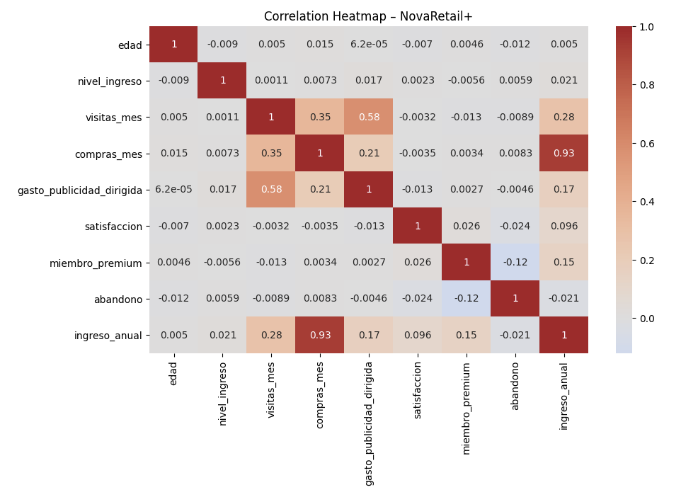

# NovaRetail+: Factores de comportamiento asociados al ingreso anual

Caso de negocio simulado del bootcamp de Data Analytics de TripleTen. Los datos son ficticios.

## Pregunta de negocio
¿Qué factores del comportamiento del cliente están más fuertemente asociados con el ingreso anual?

Es un análisis **correlacional y exploratorio**: las asociaciones que se encuentran no prueban causalidad.

## Datos
15,000 clientes y 12 columnas. Al explorarlos se detectaron 4,567 ceros ocultos (30%) en `ingreso_anual`, que se trataron como valores faltantes. En `gasto_publicidad_dirigida` también hay ceros, pero no pudo confirmarse su significado, así que se mantienen en el análisis.

## Qué hice
1. Exploración y limpieza: tipos de datos, valores faltantes y ceros ocultos.
2. Análisis descriptivo de variables numéricas, binarias y categóricas.
3. Visualización: mapa de calor de correlaciones y diagramas de dispersión de los pares relevantes.
4. Coeficientes de correlación según el tipo de variable: Pearson y Spearman (numéricas), punto-biserial (numérica y binaria) y V de Cramér (categóricas).
5. Interpretación de resultados para el negocio, con límites y próximos pasos.

## Hallazgos

*Mapa de calor de correlaciones entre las variables numéricas.*

| Relación | Coeficiente | Lectura |
|---|---|---|
| Compras al mes e ingreso anual | Pearson 0.93, Spearman 0.90 | Muy fuerte |
| Visitas al mes y gasto en publicidad dirigida | Pearson 0.58, Spearman 0.56 | Moderada |
| Visitas al mes y compras al mes | Pearson 0.35, Spearman 0.33 | Débil a moderada |
| Membresía premium e ingreso anual | 0.15 | Débil |
| Abandono e ingreso anual | −0.02 | Prácticamente nula |
| Tipo de dispositivo y región | V de Cramér 0.016 | Prácticamente nula |

- **La frecuencia de compra es el factor más asociado al ingreso anual.** Conviene validar si esa relación responde al negocio o a cómo se construyó la variable.
- **La publicidad dirigida se asocia con más visitas, pero no explica por sí sola el comportamiento de compra.**
- **El comportamiento es similar entre regiones:** el tipo de dispositivo casi no varía según la región.

## Limitaciones
- El análisis es correlacional, no causal.
- El 30% de `ingreso_anual` eran ceros interpretados como datos faltantes. Si fueran ingresos reales, los resultados cambiarían.
- Los ceros de `gasto_publicidad_dirigida` no pudieron interpretarse con certeza, así que la relación con las visitas debe leerse con cautela.

## Implicación de negocio
Priorizar la frecuencia de compra como palanca de ingreso y evaluar la publicidad dirigida con un experimento antes de ampliar su inversión.

## Herramientas
Python (pandas, NumPy, SciPy, seaborn, Matplotlib)

## Contenido
- `novaretail-analysis.ipynb`: análisis completo.

## Nota
Los datos pertenecen al bootcamp y no se incluyen en este repositorio.
